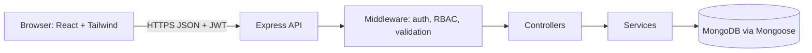
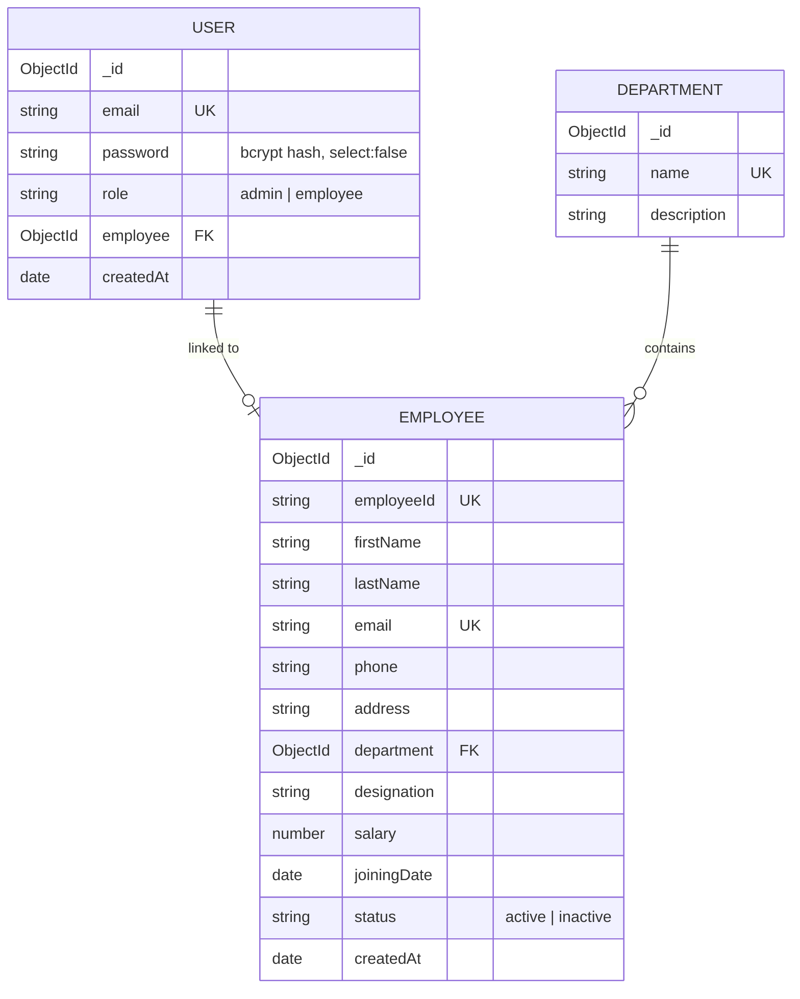
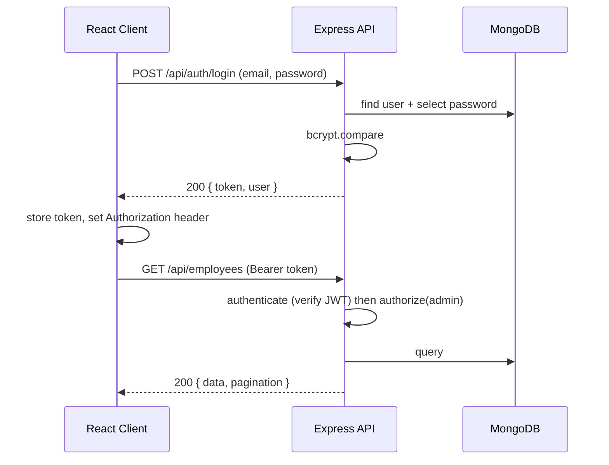

# 3. Project Architecture

## 3.1 Style
Three-tier client–server architecture with a stateless REST API.



## 3.2 Backend Layering
`routes → middleware → controllers → services → models`
- **Routes**: URL to handler mapping.
- **Middleware**: authentication, authorisation, validation.
- **Controllers**: parse request, call service, shape response.
- **Services**: business logic and DB queries.
- **Models**: Mongoose schemas.

## 3.3 Data Model



**Indexes:** `User.email` (unique), `Employee.email` (unique), `Employee.employeeId` (unique), `Employee.department`, text index on `firstName`, `lastName`, `designation`.

## 3.4 Authentication Flow

JWT payload: `{ id, role }`. Expiry: 1 day (configurable via `JWT_EXPIRES_IN`).

## 3.5 Authorization Matrix
| Endpoint group | Visitor | Employee | Admin |
|----------------|:-------:|:--------:|:-----:|
| Register / Login | ✅ | ✅ | ✅ |
| Get own profile | ❌ | ✅ | ✅ |
| Update own limited profile | ❌ | ✅ | ✅ |
| List all employees | ❌ | ❌ | ✅ |
| Create employee | ❌ | ❌ | ✅ |
| Update any employee | ❌ | ❌ | ✅ |
| Delete employee | ❌ | ❌ | ✅ |
| Dashboard stats | ❌ | ❌ | ✅ |

## 3.6 Standard API Response Format
```json
// success
{ "success": true, "data": { }, "message": "optional" }
// list
{ "success": true, "data": [ ], "pagination": { "page": 1, "limit": 10, "total": 42, "pages": 5 } }
// error
{ "success": false, "message": "Validation failed", "errors": [ { "field": "email", "message": "Invalid email" } ] }
```

## 3.7 Folder Structure
```
employee-management-system/
├── backend/
│   ├── src/
│   │   ├── config/          # db.js, env.js
│   │   ├── controllers/     # auth, employee, department, dashboard
│   │   ├── middleware/      # authenticate, authorize, validate, errorHandler, rateLimiter
│   │   ├── models/          # User, Employee, Department
│   │   ├── routes/          # auth, employee, department, dashboard
│   │   ├── services/        # business logic
│   │   ├── utils/           # ApiError, asyncHandler, generateToken
│   │   ├── validators/      # request schemas
│   │   ├── seed/            # createAdmin.js
│   │   ├── app.js           # express app setup
│   │   └── server.js        # entry point
│   ├── .env.example
│   └── package.json
├── frontend/
│   ├── public/
│   ├── src/
│   │   ├── api/             # axios instance and API calls
│   │   ├── components/      # common/, layout/, employees/, dashboard/
│   │   ├── context/         # AuthContext
│   │   ├── hooks/           # useAuth, useDebounce
│   │   ├── pages/           # Login, Register, Dashboard, Employees, EmployeeForm, Profile, NotFound
│   │   ├── routes/          # ProtectedRoute, RoleRoute, AppRoutes
│   │   ├── utils/           # formatters, validators
│   │   ├── App.jsx
│   │   ├── main.jsx
│   │   └── index.css        # Tailwind directives
│   ├── .env.example
│   ├── tailwind.config.js
│   └── package.json
└── docs/
```

## 3.8 Security Plan
- bcrypt (salt rounds 10–12); password field excluded from queries by default.
- `helmet`, `cors` with allowed origin from env, `express-rate-limit` on `/api/auth`.
- Input validation (`express-validator` or `zod`) and `express-mongo-sanitize`.
- Role never read from request body on registration.
- Secrets only in `.env`; `.env` is git-ignored.
- Generic login error ("Invalid credentials") to avoid account enumeration.

## 3.9 Tooling and Libraries (planned)
| Area | Packages |
|------|----------|
| Backend | express, mongoose, jsonwebtoken, bcryptjs, dotenv, cors, helmet, express-rate-limit, express-validator, morgan; dev: nodemon, jest, supertest, mongodb-memory-server |
| Frontend | react, react-router-dom, axios, tailwindcss, react-hot-toast, recharts, Vite |

## 3.10 Environment Variables
**Backend `.env`**: `PORT`, `MONGO_URI`, `JWT_SECRET`, `JWT_EXPIRES_IN`, `CLIENT_URL`
**Frontend `.env`**: `VITE_API_URL`

## 3.11 Deployment View (target)
Frontend on Vercel/Netlify, backend on Render/Railway, database on MongoDB Atlas.
